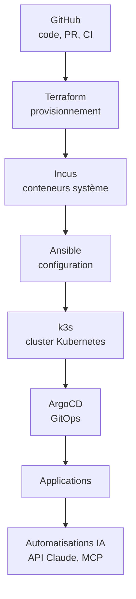

# homelab-platform

Plateforme personnelle de type entreprise, entièrement automatisée et reconstruisible en une commande, sur un simple poste Windows 11 avec WSL2.

> **Statut : en construction.** Projet de montée en compétences Platform Engineering / DevOps / Cloud / AI Infrastructure, avancé par petites étapes publiques.

## Objectif

Démontrer, avec du code reproductible, la chaîne complète d'une plateforme moderne :
infrastructure décrite en code, configuration automatisée, cluster Kubernetes, déploiements GitOps et automatisations IA.

L'ensemble tient sur une machine locale, sans coût, et se détruit ou se reconstruit à volonté :

```bash
make up       # construit tout le lab
make destroy  # supprime tout
```

> Ces commandes arriveront progressivement (voir la feuille de route).

## Architecture cible



## Environnement

| Élément | Choix |
|---|---|
| Système hôte | Windows 11 |
| Environnement Linux | WSL2, Ubuntu (systemd activé) |
| Ressources allouées | ~10 Go de RAM, 4 CPU |
| Éditeur | VS Code |
| IA | API Claude (modèles dans le cloud, rien d'hébergé en local) |

## Principes de travail

- **Commits atomiques**, un changement logique par commit.
- **Conventional Commits** (`feat(terraform): create instance module`), vérifiés par un hook.
- **Pull requests** même en solo, historique nettoyé (rebase, squash) avant fusion.
- **Aucun secret dans le dépôt** : `gitleaks` en pre-commit, `.gitignore` strict.
- **Reproductibilité d'abord** : ce qui ne se reconstruit pas par une commande n'est pas terminé.

## Feuille de route

| Mois | Thème | Livrable | Statut |
|---|---|---|---|
| 1 | Socle, Git, Bash, diagnostic de charge Linux | Bootstrap WSL2, scripts, runbooks d'incident | 🚧 en cours |
| 2 | Docker, Compose | Stack multi-services, scan d'images | ⏳ |
| 3 | Terraform | Module d'instances Incus, exercice LocalStack | ⏳ |
| 4 | Ansible | Rôles durcissement, Docker, k3s, tests Molecule | ⏳ |
| 5 | Python | CLI d'inventaire et de healthcheck | ⏳ |
| 6 | Kubernetes, k3s, Helm | Application déployée, Ingress, certificats | ⏳ |
| 7 | GitHub Actions | Pipeline lint, tests, build, plan | ⏳ |
| 8 | ArgoCD | App-of-apps, promotion par PR | ⏳ |
| 9 | Observabilité | Métriques et dashboard sur une application | ⏳ |
| 10-11 | IA appliquée | Assistant d'analyse de logs, serveur MCP, revue de `terraform plan` | ⏳ |
| 12 | Consolidation | Documentation, schémas, article de synthèse | ⏳ |

## Structure du dépôt

```text
.
├── docs/          # documentation, architecture, runbooks
├── scripts/       # scripts d'administration et de bootstrap
└── README.md
```

La structure s'enrichira avec les briques (`terraform/`, `ansible/`, `k8s/`, `gitops/`).

## Choix techniques et compromis

- **Incus plutôt que des VM** : des conteneurs système se comportent comme de vraies machines (SSH, systemd) pour Ansible, avec un coût CPU et RAM bien plus faible sur un poste personnel.
- **k3s plutôt que kubeadm** : léger et rapide à reconstruire, adapté à un lab jetable.
- **CI sans `apply`** : la CI valide et planifie, mais n'applique rien, car le lab est local.
- **Pas de cloud public pour l'instant** : zéro coût, zéro risque de facturation. LocalStack couvre les exercices de type AWS.

## Prérequis

- Windows 11 avec WSL2 (Ubuntu) et systemd activé
- 16 Go de RAM recommandés (10 Go alloués à WSL2)
- Git, `pre-commit`

## Documentation

La documentation de chaque brique est dans `docs/`. Les notes d'apprentissage restent privées.

## Licence

MIT. Voir [LICENSE](LICENSE).
